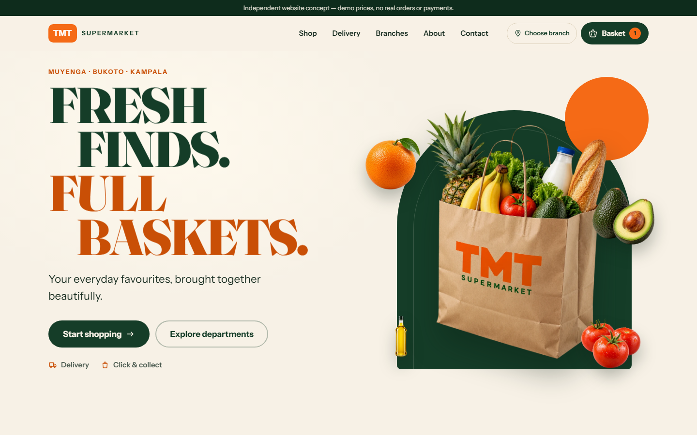

# TMT Supermarket — website concept

An independent developer portfolio concept for a neighbourhood supermarket in Kampala: an art-directed
GSAP landing page connected to a working shop, basket, delivery and click-and-collect checkout, and an
enquiry form — all running in the browser with no backend.

**Live:** https://tmt-supermarket-concept.pages.dev

> **Independent concept.** Not affiliated with, endorsed by or operated for TMT Supermarket. Prices,
> availability, fees and time windows are demonstration data. No payments are taken and no orders or
> enquiries are sent. All imagery is AI-generated concept art.



## Features

- **Landing page** — layered hero (bag cutout, separate produce layers, live HTML headline) with a short GSAP
  entrance; scroll moments for produce separating, an editorial department reveal, a kinetic typographic
  band and groceries travelling into the delivery story. Desktop and mobile choreography differ; reduced
  motion gets a complete static page.
- **Shop** — 22 demo products in four departments; search by name and keywords, department filter, price
  and name sort, active-filter chips and reset. Search, department and sort live in the URL.
- **Product pages** — image, description, sale unit, illustrative price, demo availability, options where
  relevant (avocado ripeness), validated quantity entry, related products.
- **Basket** — shared by the quick drawer and `/cart`; merges same product + option, quantity limits,
  direct entry with validation, remove, two-step clear. Persisted locally (versioned, validated, recovers
  from malformed data); no personal data is stored.
- **Checkout** — fulfilment → details → review, each stage addressable for Back/Forward. Delivery or
  click and collect from Muyenga or Bukoto, Ugandan phone validation, Kampala-time date rules, sample
  details, centrally configured demo fee, duplicate-submit protection and an in-memory confirmation with
  print and fallback on refresh.
- **Delivery, Branches, Contact, About** — delivery explainer with an area preference, branch selection
  that carries into shop and checkout, an enquiry form with conditional fields → preview → demo
  confirmation, and a full concept disclosure.

## Stack

React 19 · TypeScript · Vite 7 · React Router 7 (data router, lazy routes) · GSAP 3 + ScrollTrigger via
`@gsap/react` · plain CSS with design tokens · Vitest · Playwright for journey checks.

State is three small React contexts (basket, preferences, in-memory checkout) plus a toast region — no
state library. Catalogue, branches and fulfilment policy are typed data in `src/data` and `src/config`;
calculations and validation are pure functions in `src/lib`, so a backend can replace them later.
GSAP is loaded only with the homepage chunk.

## Develop

```bash
npm install
npm run dev          # http://127.0.0.1:5173
npm test             # unit tests: basket maths, merging, persistence, fees, validation, checkout stages
npm run build        # type-check + production build to dist/
npm run preview      # serve dist/ at http://127.0.0.1:4173
npm run verify       # Playwright journeys against the preview (uses local Chrome; set CHROME_PATH if elsewhere)
npm run images       # regenerate web images from assets-src/original (Python 3 + Pillow)
```

`npm run verify` covers the 12 required journeys, horizontal overflow and image loading at 360, 390, 768,
1024 and 1440px, and fails if any non-GET or third-party request (other than Google Fonts) is made.
Run it against production with `VERIFY_URL=https://tmt-supermarket-concept.pages.dev npm run verify`.

## Demo boundaries

- No database, payment integration, authentication, analytics or external form submission.
- Prices, units, stock states, the UGX 5,000 demo delivery fee and time windows are illustrative
  (`src/config/fulfilment.ts`).
- Personal details stay in React memory for the visit; only basket ids/quantities and the branch
  preference are saved to `localStorage`.
- Branch locations come from TMT Supermarket's public social posts. Hours, phone numbers and services
  could not be verified and are deliberately omitted.

## Assets

See [docs/ASSETS.md](docs/ASSETS.md) for originals, derivatives, the bag-fringe clean-up and the product
crops taken from department photographs. Artwork is not open-source licensed.

## Deploy (Cloudflare Pages, Direct Upload)

```bash
npx wrangler login         # once
npm run deploy             # build + wrangler pages deploy dist --project-name tmt-supermarket-concept
```

`public/_redirects` serves `index.html` for every route so direct links and refreshes work, and
`public/_headers` sets caching and basic security headers. Open Graph URLs use `VITE_SITE_URL` from
`.env.production`; update it if the site moves to another domain. After deploying, run the verify
script against the live URL.
